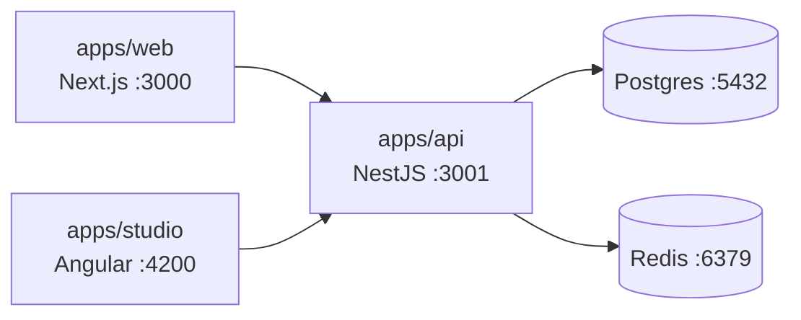

# cro-sport-hub

Version 1 runs locally: a public Next.js site, an Angular editorial studio, and a NestJS API backed by Postgres and Redis. Seed and test data only. Sport admin and user admin are out of v1. The hourly import timer is off unless `IMPORT_SCHEDULE` is exactly `true`; when enabled, the job runs once per hour. Gallery is in v1: football slides built from catalog fields with one optional caption, plus a ZIP download of an approved gallery. The visitor walk (`vp run verify:visitor`) and editor flow (`vp run verify:editor`) are local Playwright commands and are not part of default CI. Feature detail lives in `docs/feature-map.md`; this file is how to run the stack.

## Architecture



## Requirements

- Node.js 24.22.1 (`.node-version`)
- [Vite+](https://viteplus.dev) 1.4.0 as `vp` (or `pnpm exec vp`)
- Docker Compose for Postgres 18 and Redis 8

## Run locally

From the repository root:

```bash
docker compose up
```

Copy `.env.example` to `.env`. Set `DATABASE_URL` to use `POSTGRES_PASSWORD` from `docker-compose.yml` (the example file uses a different placeholder). Set `JWT_SECRET`, `EDITOR_DEMO_PASSWORD`, and `ADMIN_DEMO_PASSWORD` to your own placeholders (see [Demo login](#demo-login)).

Install workspace dependencies:

```bash
vp install
```

Load the fictional catalog and hash demo passwords onto the seeded users:

```bash
vp run api#seed
```

Start the API, studio, and web dev servers (three processes in one terminal):

```bash
vp run -r dev
```

| App    | URL                   |
| ------ | --------------------- |
| Web    | http://localhost:3000 |
| Studio | http://localhost:4200 |
| API    | http://localhost:3001 |

OpenAPI: http://localhost:3001/docs (JSON at `/docs-json`). Health: `GET http://localhost:3001/health` (503 when Postgres or Redis is down).

`vp run api#seed` reads the root `.env` like `vp run api#dev`. It writes through the catalog and skips rows already stored. Sample names only: no photos and no crests.

To run one app at a time:

```bash
vp run api#dev      # http://localhost:3001
vp run studio#dev   # http://localhost:4200
vp run web#dev      # http://localhost:3000
```

Build the API container image from the repository root: `docker build -f apps/api/Dockerfile .`.

## Demo login

Studio login uses two catalog user ids: `editor-demo` (editor) and `admin-demo` (admin). Set these environment variables in `.env` before `vp run api#seed`:

- `JWT_SECRET` — signs `POST /api/login` (at least 32 characters)
- `EDITOR_DEMO_PASSWORD` — hashed onto `editor-demo` (8 to 72 characters)
- `ADMIN_DEMO_PASSWORD` — hashed onto `admin-demo` (8 to 72 characters)

Placeholders are in `.env.example`. The README never stores secret values; seed fails if a variable is missing or too short.

## Local Playwright flows

First run on a machine: `vp exec playwright install chromium`.

With Compose, seed, and `vp run -r dev` up:

```bash
vp run verify:visitor
vp run verify:editor
```

These need the demo password variables in the environment. They are not run in the default CI job.

## Layout

- `apps/web` — Next.js App Router
- `apps/studio` — Angular standalone components and signals
- `apps/api` — NestJS
- `libs/shared-types`, `libs/ui`, `libs/slide-generator` — workspace packages (slide renderer: ADR-003)

## Architecture decisions (ADRs)

| ADR                                           | Topic                                                  |
| --------------------------------------------- | ------------------------------------------------------ |
| [001](docs/adr/001-vite-plus-vs-nx.md)        | Vite+ instead of Nx for tasks, lint, and format        |
| [002](docs/adr/002-drizzle-vs-prisma.md)      | Drizzle ORM and SQL migrations for the catalog         |
| [003](docs/adr/003-slide-renderer.md)         | Chromium HTML rendering for football slides            |
| [004](docs/adr/004-jwt-and-password-hash.md)  | JWT login with bcryptjs for demo users                 |
| [005](docs/adr/005-nestjs-schedule-import.md) | Hourly fixture import when `IMPORT_SCHEDULE=true`      |
| [006](docs/adr/006-gallery-zip-fflate.md)     | Gallery ZIP download with `fflate`                     |
| [007](docs/adr/007-api-feature-files.md)      | New API features as new files, not growing controllers |
| [008](docs/adr/008-studio-feature-routes.md)  | Studio routes lazy-loaded per feature                  |
| [009](docs/adr/009-studio-feature-clients.md) | Studio HTTP clients colocated per feature              |

## Check the repo

Pull requests run the checks in `AGENTS.md`. From the repository root:

```bash
vp run format-check
vp run lint
vp run typecheck
vp run test
vp run build
```

Toolchain and task-runner choices: [ADR-001](docs/adr/001-vite-plus-vs-nx.md).
